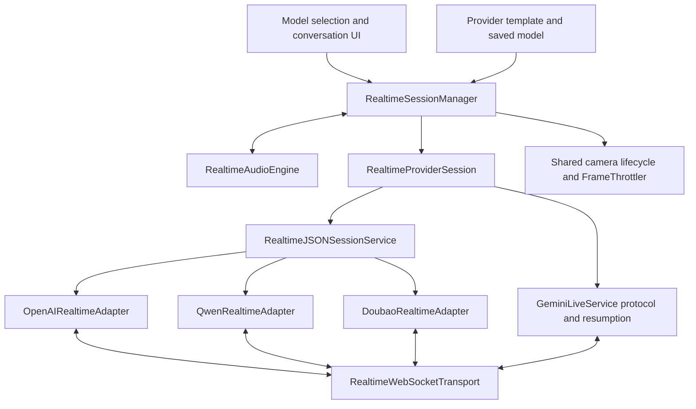

# Live provider adapters

Status: implemented locally on 2026-10-11; authenticated Qwen/Doubao smoke tests
remain pending. See [setup and verification status](../compatible-realtime.md).

## Result

Add Model offers Chat and Realtime. Realtime offers OpenAI, Gemini, Qwen Omni (China
API), Qwen Audio (China API), Doubao and Custom/compatible. Chat adds Qwen (China API) and Doubao (Ark API)
templates using the existing OpenAI-compatible HTTP implementation.

Provider templates supply editable defaults; each saved live model holds its own
endpoint, credentials, model, voice and explicit protocol version. Secrets are
stored in Keychain. A session resolves an immutable descriptor before acquiring
audio, camera or network resources. Reconnects retain that descriptor.

## Implementation boundaries

- `RealtimeProviderCatalog.swift`: chat/live templates, versioned profiles,
  capabilities and media policies, request authentication, endpoint validation, Keychain model
  storage and one-time migration. Unknown protocol versions fail explicitly.
- `RealtimeSessionManager.swift`: common start/stop, session identity, microphone
  and camera lifecycle, transcripts, tool dispatch, playback interruption, job
  delivery, context recording and recovery coordination. The old Gemini/OpenAI
  manager types are compatibility wrappers around this coordinator.
- `RealtimeProviderSession.swift`: normalized provider session interface.
  Gemini retains its tested setup, model retirement, transcription, tool
  cancellation and resumption state machine in `GeminiLiveService`; it shares
  the coordinator, audio engine and socket transport. Its protocol-specific
  retry/resumption work stays in that service.
- `RealtimeJSONSessionService.swift`: adapter-driven readiness, serialized
  encoding/decoding, reconnect backoff, stale-connection rejection, media handling
  and usage normalization for OpenAI, Qwen and Doubao. A fake transport and
  injectable clock exercise startup, terminal errors, retries and stopping.
- `RealtimeProtocolAdapter.swift`: typed commands/events and adapter registry.
  Wire formats are in provider-specific files under `OpenAIRealtime`,
  `QwenRealtime` and `DoubaoRealtime`. Adapters own session payloads, event
  decoding, tools, interruption and error classification.
- `RealtimeWebSocketTransport.swift`: per-connection delegate, ordered sends,
  cancellation, audio pacing, bounded buffering and a policy-checked socket
  opening boundary. Provider request builders and services also apply endpoint
  and medical egress guards before attaching/sending credentials.
- `RealtimeModelsView.swift` and `ModelFormView.swift`: shared model setup,
  provider templates and a handshake-only Test Connection action. Capabilities
  gate camera controls, sharp-photo tools and app text injection.

PCM16 mono input is 24 kHz for the OpenAI profile and 16 kHz for the other
profiles; output is 24 kHz. Doubao explicitly requests Int16 output rather than
its default float PCM, packetizes input into 20 ms frames and sends mute/unmute
commits. Qwen uses audio-before-image ordering, bounded JPEGs and at most 1 fps
for background frames. Encoding and image work run off the main actor.

## Adding or changing a provider

1. For a provider implementing an existing contract, add a catalog template or
   configure Custom with that explicit profile. No new AppMode or session manager
   is required.
2. For a different wire contract, add a versioned profile, capabilities/audio
   metadata, an adapter and a registry entry. Put its authentication rules in the
   request builder. Keep app lifecycle behavior in the common coordinator.
3. Keep model aliases separate from protocol versions. A new model default must
   not silently change a saved model's protocol. Add a new profile when the
   handshake, framing or event semantics change; do not guess by hostname.
4. Add sanitized contract fixtures and readiness, audio, transcript, tools,
   interruption, unsupported-operation and error tests. Use fake transport/clock
   tests for any new lifecycle assumptions, then run an authenticated smoke test.

No JSON transformation language or automatic cross-protocol fallback is used.
A binary Doubao protocol, for example, needs its own framing adapter rather than
another endpoint string in the JSON profile.

## Completed checks and remaining validation

- [x] Common coordinator and ordered transport for existing OpenAI and Gemini
- [x] OpenAI golden payload and existing Gemini setup/resumption coverage retained
- [x] Native Qwen and Doubao JSON adapters with documentation-derived fixtures
- [x] Chat/Realtime provider selection, editable defaults and Keychain persistence
- [x] Legacy settings migration and independent chat/live credentials
- [x] Capability-driven media and text-delivery admission
- [x] Fake transport/clock coverage for readiness, retry, auth rejection and stop
- [x] Build and focused regression suites, privacy logging and network inventory
- [ ] Authenticated Qwen/Doubao audio, camera/tool and interruption/reconnect tests
- [ ] Hardware verification of the new provider configurations

Validation: 338 tests passed in the focused regression run, followed by 21
provider/engine tests including the additional Qwen pixel-size test. The Add Model
UI test passed for both live providers and both chat templates. The privacy
logging gate and `git diff --check` passed. Runs used Xcode 27 and the iPhone 18 Pro
simulator; none of these used authenticated Qwen/Doubao account sessions.

The fixtures demonstrate the app's interpretation of the current documentation;
only authenticated tests can establish acceptance by the deployed servers.
Doubao usage normalization remains unavailable until its usage payload is verified.
The legacy AppMode identities and manager wrappers are deliberately retained for
persisted settings and existing launch callers.

## Provider text delivery follow-up

Implemented separate context-update, generated-text-turn and supplied-speech
capabilities. Added the Qwen Audio v1 profile/template and adapter; Qwen Omni
keeps its vision contract and does not claim text turns. Doubao uses native
replacement speech, while its app context travels through session instructions.
The common engine owns bounded replaceable job/debrief/announcement context and
reconnect retention. The job bridge uses context capability independently of
model reply generation. Notification delivery and summaries select native exact
speech, a generated turn, or local speech with a subsequent context update.

Contract references checked on 2026-10-11:
- https://www.alibabacloud.com/help/en/model-studio/client-events
- https://www.alibabacloud.com/help/en/model-studio/fun-audiochat-client-events
- https://www.alibabacloud.com/help/en/model-studio/qwen-audio-realtime-user-guides
- https://docs.volcengine.com/docs/DoubaoVoice/endtoend-realtime-voice-full-duplex-version?lang=zh

Pending authenticated checks: Qwen Audio text-to-audio turns; Qwen Omni context
visibility after session updates; Doubao direct speech and follow-up context;
all three during interruption and reconnect. No proxy or fabricated tool calls
are used as a workaround.

Follow-up validation: 131 selected unit/regression tests passed on the final
built bundle, including 10 text-contract/announcement tests and engine coverage
for context retention and native speech. Privacy logging and whitespace checks
passed. The first final-run attempt built successfully but failed to launch the
simulator test app before any tests; the same built bundle passed on retry.

The Add Model UI test also passed for Qwen Omni, Qwen Audio and Doubao defaults,
and for the existing Qwen/Doubao Chat templates (1 test, 118.6 seconds). This UI
run used no credentials or live provider connection.

Device packaging check (2026-10-11): the Debug iPhone build succeeded with normal
signing, installed on the attached iPhone Air (iOS 27.0.1, Developer Mode enabled),
and launched successfully as version 2026.10 (492). A subsequent device process
snapshot confirmed the app remained running. All 1,020 localization lookups also
passed against the resources packaged in that device build. This verifies device
build/install/launch and resource packaging; authenticated provider audio, tools,
interruption/reconnect and device UI localization remain pending.

PR preparation check (2026-10-11): rebased the feature onto main after the camera
and full-language-catalog PRs merged. The exact isolated PR checkout builds and
passes **209 selected regression tests** with zero failures. The privacy logging
gate, whitespace checks, catalog compilation and all **1,020 native localization
lookups** pass. The catalog adds only this feature's 85 keys and reactivates the
existing session-button key; all translations already on main are preserved.
